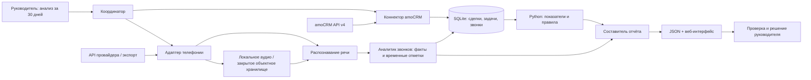

# Архитектура PULSE

Запрос руководителя задаёт период, например 30 дней. Координатор фиксирует время среза, загружает источники, запускает расчёты и собирает отчёт. Демо выполняет этот путь локально на синтетических данных; подключение AI и внешних источников запускается отдельными командами.

**Координатор** управляет шагами и полнотой данных. Сделки и задачи получаются через `GET /api/v4/leads` и `GET /api/v4/tasks`; дополнительно читаются пользователи и этапы воронок. Коннектор использует Bearer-токен, пагинацию и повторы временных ошибок. Доступ зависит от прав пользователя. Выдача и обновление OAuth-токена — отдельный процесс, не реализованный в MVP. См. документацию [сделок](https://www.amocrm.ru/developers/content/crm_platform/leads-api), [задач](https://www.amocrm.ru/developers/content/crm_platform/tasks-api) и [OAuth](https://www.amocrm.ru/developers/content/oauth/step-by-step).

**Аналитик звонков** получает нормализованные записи: ID звонка, сделку, менеджера, время, длительность и расшифровку. В MVP реализован JSON-импорт; API конкретного провайдера телефонии подключается его собственным адаптером. В полном контуре адаптер получает метаданные и запись, ASR возвращает текст с временными отметками, LLM — договорённости, возражения и следующий шаг. LLM должен возвращать структурированный результат и ссылаться на существующие фрагменты текста. Связь звонка со сделкой проверяется по явному ID; одного совпавшего телефона недостаточно для уверенной атрибуции.

**Составитель отчёта** объединяет рассчитанные кодом показатели с выводами по звонкам. Суммы, доля успешных закрытий, отсутствие задач и просрочки не поручаются LLM. Каждый вывод по разговору сопровождается текстовым подтверждением и временной отметкой. Несовпадение договорённости с задачей помечается как предложение для проверки.

SQLite хранит нормализованные сделки, задачи, звонки и результаты анализа. Аудио хранится отдельно: локально в MVP, в закрытом объектном хранилище при развёртывании. Рабочая база и реальные отчёты остаются в `runtime/`; статический `dist/` содержит только вымышленные данные. Ключи передаются через окружение и не попадают в интерфейс.

Новые и закрытые сделки и звонки считаются за выбранный период. Открытая воронка и нарушения задач — текущий срез всех открытых сделок. Для исторической динамики этапов нужен журнал событий; текущий список сделок его не заменяет. Руководитель утверждает действия: автоматическая запись в CRM в MVP отсутствует.
